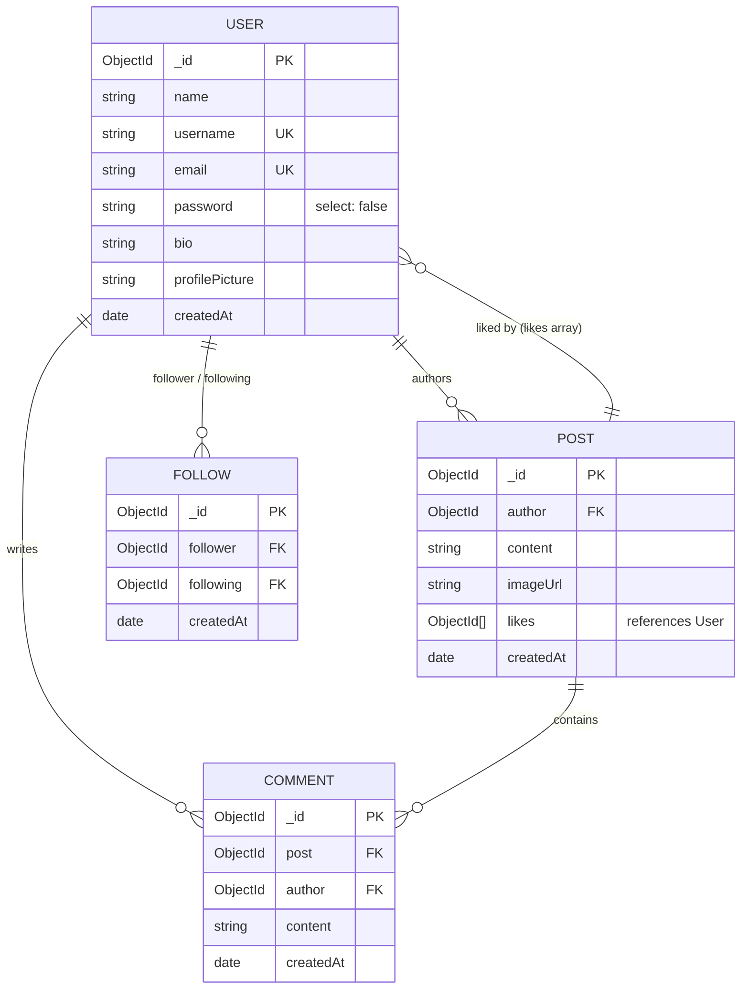

# Mini Social Media Platform 🚀

A modern, secure, and beginner-friendly full-stack social media web application built for an internship project using **Node.js**, **Express.js**, **MongoDB Atlas**, **Mongoose**, **HTML5**, **CSS3**, and **Vanilla JavaScript (ES Modules)**.

---

## 1. Project Overview

The **Mini Social Media Platform** allows users to create accounts, personalize profiles, publish posts with optional image attachments, explore public community feeds as well as personalized following feeds, interact with posts via likes and comments, and follow/unfollow peers.

Designed following production-ready software patterns:
- **Modular MVC Architecture** (Separation of Models, Controllers, Routes, and Middleware)
- **Cookie-Based JWT Authentication** (`HttpOnly`, `SameSite`, `Secure`)
- **Strict Data Validation & Sanitization** (Type checking, length validation, regex injection mitigation)
- **High Concurrency Safety** (Atomic `$addToSet`, `$pull`, and compound unique indexes)
- **Automated Integration Testing** (71 passing integration tests across 6 dedicated test suites)

---

## 2. Features

- **User Authentication**:
  - Secure registration, password hashing with `bcryptjs` (salt rounds: 10).
  - Login via email or username.
  - Session verification via `GET /api/v1/auth/me`.
  - Secure logout clearing the HttpOnly cookie.
  - Brute-force rate limiting on auth endpoints (10 attempts per 15 mins).
- **User Profiles & Discovery**:
  - Public profile pages with bio, avatar, joined date, post count, and follow counts.
  - Profile editing modal for name, username, bio, and profile picture URL.
  - Real-time user search by name or `@username` with ReDoS-safe regex escaping.
  - Followers and Following directory modals with clickable user cards.
- **Posts & Community Feed**:
  - Rich text posts (up to 1,000 characters) with optional image URLs.
  - Global chronological Community Feed with pagination (`page`, `limit`).
  - Safe post editing and deletion restricted exclusively to the original author.
  - Post cleanup: Deleting a post automatically cascades and purges all associated comments.
- **Interactions (Likes & Comments)**:
  - Idempotent Like/Unlike toggle (`PUT` / `DELETE`) powered by atomic MongoDB operators.
  - Real-time comment threads (up to 500 characters) displayed chronologically.
  - Dual moderation permissions: comments can be deleted by either the comment author OR the parent post's owner.
- **Social Graph & Personalized Feed**:
  - Follow / Unfollow functionality with compound unique index preventing duplicates.
  - Dedicated private Following Feed (`GET /api/v1/posts/feed`) aggregating posts from followed peers and the current user.
  - Responsive tab switcher on the Home feed (`🌐 Community Feed` vs `👥 Following Feed`).

---

## 3. Technology Stack

### Backend
- **Runtime Environment**: Node.js (v18.0.0+ recommended, ES Modules `"type": "module"`)
- **Web Framework**: Express.js (v4.19.2)
- **Database & ODM**: MongoDB Atlas / Mongoose (v8.4.0)
- **Security & Authentication**:
  - `bcryptjs` for one-way password hashing
  - `jsonwebtoken` (JWT) for stateless signed session tokens
  - `cookie-parser` for HttpOnly cookie extraction
  - `cors` with credentials support and domain whitelist configuration
  - Custom in-memory sliding-window rate limiter

### Frontend
- **Markup & Styling**: HTML5, Modern CSS3 (Variables, Flexbox, Grid, Mobile Media Queries)
- **Client Scripting**: Vanilla JavaScript (Modern ES6+, Async/Await, DOM API)
- **Security**: Strict XSS prevention using `textContent` and sanitization routines; `credentials: 'include'` on all `fetch()` calls.

---

## 4. Project Folder Structure

```text
social-media-platform/
│
├── backend/                               # Express.js REST API service
│   ├── config/
│   │   └── db.js                          # Mongoose connection & DNS setup
│   ├── controllers/
│   │   ├── auth.controller.js             # Register, login, logout, getMe
│   │   ├── comment.controller.js          # Create, list, delete comments
│   │   ├── follow.controller.js           # Follow, unfollow, follower/following lists
│   │   ├── like.controller.js             # Like & unlike toggle logic
│   │   ├── post.controller.js             # CRUD posts, public feed, following feed
│   │   └── user.controller.js             # Profiles, search, profile updates
│   ├── middleware/
│   │   ├── auth.middleware.js             # JWT verification (protect)
│   │   └── rateLimiter.middleware.js      # Sliding-window rate limiting
│   ├── models/
│   │   ├── comment.model.js               # Comment schema (post, author, content)
│   │   ├── follow.model.js                # Follow schema (follower, following + unique index)
│   │   ├── post.model.js                  # Post schema (author, content, imageUrl, likes)
│   │   └── user.model.js                  # User schema (name, username, email, password)
│   ├── routes/
│   │   ├── auth.routes.js                 # /api/v1/auth
│   │   ├── comment.routes.js              # /api/v1/posts/:postId/comments & /api/v1/comments/:id
│   │   ├── follow.routes.js               # /api/v1/users/:id/follow, /followers, /following
│   │   ├── like.routes.js                 # /api/v1/posts/:id/like
│   │   ├── post.routes.js                 # /api/v1/posts
│   │   └── user.routes.js                 # /api/v1/users
│   ├── tests/
│   │   ├── test_auth_flow.js              # 12 Authentication tests (port 5555)
│   │   ├── test_profile_flow.js           # 11 Profile & Search tests (port 5556)
│   │   ├── test_post_flow.js              # 13 Post CRUD & Feed tests (port 5557)
│   │   ├── test_comment_flow.js           # 9 Comment flow & moderation tests (port 5558)
│   │   ├── test_like_flow.js              # 8 Like toggle & concurrency tests (port 5559)
│   │   └── test_follow_flow.js            # 18 Follow & Personalized feed tests (port 5560)
│   ├── utils/
│   │   └── generateToken.js               # JWT signing & cookie helpers
│   ├── .env                               # Local secrets (ignored by git)
│   ├── .env.example                       # Environment configuration template
│   ├── app.js                             # Express application assembly & security headers
│   ├── package.json                       # Scripts, dependencies & engine configs
│   └── server.js                          # Entry point listener
│
├── frontend/                              # Static frontend served by Express
│   ├── assets/                            # Brand icons, badges, placeholders
│   ├── css/
│   │   └── style.css                      # Unified design system & responsive rules
│   ├── js/
│   │   └── main.js                        # Client controllers, state & DOM renderer
│   ├── index.html                         # Home feed & post creator view
│   ├── login.html                         # User login view
│   ├── register.html                      # Account registration view
│   └── profile.html                       # Profile, stats, edit modal & follow lists
│
├── .gitignore                             # Git exclusion rules
└── README.md                              # Complete platform documentation
```

---

## 5. Installation Instructions

### Step 1: Clone Repository
```bash
git clone https://github.com/your-username/social-media-platform.git
cd social-media-platform/backend
```

### Step 2: Install Dependencies
```bash
npm install
```

---

## 6. Environment Variable Configuration

Create a `.env` file in the `backend/` directory by copying the template:

```bash
# On Windows (PowerShell)
Copy-Item .env.example .env

# On Linux/macOS
cp .env.example .env
```

Edit `backend/.env` with your settings:

```env
PORT=5000
NODE_ENV=development
MONGODB_URI=mongodb+srv://<username>:<password>@cluster0.vttyr94.mongodb.net/mini_social_media?retryWrites=true&w=majority
JWT_SECRET=super_secret_jwt_key_for_signing_sessions_12345
JWT_EXPIRE=30d
CLIENT_URL=http://localhost:5000
```

---

## 7. MongoDB Atlas Setup

1. Create a free M0 cluster on [MongoDB Atlas](https://www.mongodb.com/cloud/atlas).
2. Under **Database Access**, create a database user with `Read and write to any database` privileges.
3. Under **Network Access**, add `0.0.0.0/0` (Allow Access from Anywhere) or your server's static IP.
4. Click **Connect** -> **Connect your application** -> Copy the SRV connection string:
   ```text
   mongodb+srv://<username>:<password>@cluster0.vttyr94.mongodb.net/mini_social_media?retryWrites=true&w=majority
   ```
5. Paste this connection string into your `backend/.env` file under `MONGODB_URI`.

*(Note: On Windows systems experiencing DNS SRV resolution issues, `backend/config/db.js` automatically configures Google DNS `8.8.8.8` / `8.8.4.4` to ensure uninterrupted connectivity).*

---

## 8. Running the Backend

### Development Mode (with automatic reload via nodemon):
```bash
cd backend
npm run dev
```

### Production Mode:
```bash
cd backend
npm start
```

The server starts on `http://localhost:5000`.

---

## 9. Running the Frontend

The Express server serves the static frontend directly from `../frontend` at the root URL:
- Open your browser at: **[http://localhost:5000/](http://localhost:5000/)**
- Direct page routes:
  - Home & Feeds: `/`
  - Login: `/login`
  - Register: `/register`
  - User Profile: `/profile` (or `/profile?id=<userId>`)

---

## 10. API Endpoint Documentation

### Authentication (`/api/v1/auth`)
| Method | Endpoint | Access | Description |
|:---|:---|:---|:---|
| `POST` | `/register` | Public | Register account (`name`, `username`, `email`, `password`). Issues HttpOnly cookie. |
| `POST` | `/login` | Public | Sign in (`email` or `username` + `password`). Issues HttpOnly cookie. |
| `POST` | `/logout` | Public | Clears session cookie. |
| `GET` | `/me` | Private | Returns current authenticated user session. |

### User Profiles & Search (`/api/v1/users`)
| Method | Endpoint | Access | Description |
|:---|:---|:---|:---|
| `GET` | `/search?q=...` | Public | Search users by name or username (sanitized regex). |
| `PATCH` | `/me` | Private | Update own profile (`name`, `username`, `bio`, `profilePicture`). |
| `GET` | `/:id` | Public | Get public profile with dynamic follower and following counts. |

### Posts & Feeds (`/api/v1/posts`)
| Method | Endpoint | Access | Description |
|:---|:---|:---|:---|
| `POST` | `/` | Private | Publish post (`content`, optional `imageUrl`). Author bound to `req.user._id`. |
| `GET` | `/?page=1&limit=10` | Private | Get global Community Feed (newest first). |
| `GET` | `/feed?page=1&limit=10` | Private | Get personalized Following Feed (followed users + author's own posts). |
| `GET` | `/user/:userId` | Public | Get all posts published by a specific user. |
| `GET` | `/:id` | Public | Get single post details with safe author info. |
| `PATCH` | `/:id` | Private (Author) | Edit post content and/or image attachment. |
| `DELETE` | `/:id` | Private (Author) | Delete post and cascade delete its comments. |

### Interactions: Likes & Comments
| Method | Endpoint | Access | Description |
|:---|:---|:---|:---|
| `PUT` | `/posts/:id/like` | Private | Idempotently like a post (`$addToSet`). Returns `{ likesCount, isLiked }`. |
| `DELETE` | `/posts/:id/like` | Private | Idempotently unlike a post (`$pull`). Returns `{ likesCount, isLiked }`. |
| `POST` | `/posts/:postId/comments` | Private | Add comment to post (`content`). |
| `GET` | `/posts/:postId/comments` | Public | Retrieve paginated comments for post (oldest first). |
| `DELETE` | `/comments/:id` | Private | Delete comment (allowed for comment author OR post owner). |

### Social Graph: Follow System
| Method | Endpoint | Access | Description |
|:---|:---|:---|:---|
| `POST` | `/users/:id/follow` | Private | Follow user. Rejects self-follow and duplicate follows. |
| `DELETE` | `/users/:id/follow` | Private | Unfollow user. Returns updated counts. |
| `GET` | `/users/:id/follow-status` | Private | Check if current user follows `:id`. |
| `GET` | `/users/:id/followers` | Public | List followers with pagination. |
| `GET` | `/users/:id/following` | Public | List users followed with pagination. |

---

## 11. Testing Instructions

The platform includes an automated end-to-end integration test suite spanning **71 tests** across 6 dedicated test suites. Each suite runs on a dedicated port and uses isolated test accounts cleaned up before and after execution.

```bash
cd backend

# Run the complete test suite (all 71 tests sequentially)
npm test

# Run individual test suites
npm run test:auth       # 12 Authentication tests (port 5555)
npm run test:profile    # 11 Profile & Search tests (port 5556)
npm run test:posts      # 13 Post & Feed tests (port 5557)
npm run test:comments   # 9 Comment flow tests (port 5558)
npm run test:likes      # 8 Like toggle tests (port 5559)
npm run test:follow     # 18 Follow & Personalized feed tests (port 5560)
```

---

## 12. Authentication Architecture

```mermaid
flowchart TD
    Client[Client Browser]
    Server[Express API Server]
    Cookie[HttpOnly JWT Cookie]
    Middleware[auth.middleware.js]
    Protected[Protected Route / Controller]

    Client -->|1. POST /login or /register| Server
    Server -->|2. Verify credentials & Sign JWT| Server
    Server -->|3. Set-Cookie: token=JWT; HttpOnly; SameSite=Lax| Cookie
    Cookie -.->|Automatic on subsequent requests| Client
    Client -->|4. fetch() with credentials: 'include'| Middleware
    Middleware -->|5. Read req.cookies.token or Bearer header| Middleware
    Middleware -->|6. jwt.verify() & User.findById()| Middleware
    Middleware -->|7. Attach user to req.user| Protected
```

- **Token Storage**: JWT is stored exclusively in an **HttpOnly cookie**. Client-side JavaScript cannot read `document.cookie`, providing robust defense against Cross-Site Scripting (XSS) credential theft.
- **CSRF Defense**: Cookies are configured with `SameSite: 'lax'` (or `'strict'` in production). Browsers will not attach cookies on cross-origin mutation requests (POST/PUT/DELETE).
- **Bearer Header Fallback**: For API consumers or automated tests, `auth.middleware.js` also accepts `Authorization: Bearer <token>`.

---

## 13. Database Collections and Relationships



- **User**: Central identity document. Passwords excluded by default (`select: false`).
- **Post**: Holds content and an array of User ObjectIds (`likes`). Index on `{ createdAt: -1 }`.
- **Comment**: Dedicated collection referencing parent `post` and `author`. Compound index on `{ post: 1, createdAt: 1 }`.
- **Follow**: Dedicated social graph collection. Compound unique index on `{ follower: 1, following: 1 }` prevents duplicates and race conditions.

---

## 14. Deployment Preparation

1. **Production Environment Variables**:
   - Set `NODE_ENV=production`.
   - Set `JWT_SECRET` to a high-entropy string (e.g. `openssl rand -hex 32`).
   - Set `CLIENT_URL` to your production domain(s) to enforce strict CORS origin validation.
2. **Reverse Proxy & TLS/HTTPS**:
   - In production, deploy behind Nginx or a managed PaaS (e.g., Render, Railway, AWS ECS).
   - Ensure HTTPS is enabled. When `NODE_ENV=production`, cookies automatically switch to `Secure: true` and `SameSite: 'strict'`.
3. **Database Performance**:
   - Ensure MongoDB Atlas connection pool matches expected concurrency.
   - All critical queries utilize compound indexes (`follower + following`, `post + createdAt`, `author + createdAt`).

---

## 15. Known Limitations

- **File Upload Storage**: Post images and profile avatars currently store direct HTTP/HTTPS URLs (e.g., Unsplash or external CDNs). Local file upload with S3/Cloudinary bucket integration is reserved for future major revisions.
- **Real-Time WebSockets**: Feed updates and comment insertions are fetched over REST. Live real-time updates via WebSockets/Socket.IO can be added in subsequent phases.
